# Wardrobe Scout: correctness fixes and first redesign: handoff

Branch `feature/redesign-and-fixes`. Not merged, not deployed. Every run in this work used disposable databases
and synthetic data; no live database was opened, no paid API was called, and the end-to-end runs contact no
website other than the synthetic demo catalogue on this computer.

**Real taste accuracy is unproven.** Nothing here measures how well the app predicts what you will like. The
plan for a fair first measurement on your own data is in [02-measurement.md](02-measurement.md#real-data-plan-for-a-fair-first-test).

## Contents

1. [Commits](#commits)
2. [What changed, in plain English](#what-changed-in-plain-english)
3. [What each decision means](#what-each-decision-means)
4. [Findings and their status](#findings-and-their-status)
5. [Design rationale, with screenshots](#design-rationale-with-screenshots)
6. [Results: executed, synthetic, planned](#results-executed-synthetic-planned)
7. [Upgrade, backup and rollback](#upgrade-backup-and-rollback)
8. [Remaining work](#remaining-work)
9. [Baseline (where this started)](#baseline-where-this-started)

## Commits

In the order the brief asked for. Each commit's message lists what it changed and its tests.

| Commit | What |
|---|---|
| `6ae0b38` | Baseline: screenshot script, 36 "before" screenshots, this handoff with the base commit and findings |
| `cec111a` | Calibration lifecycle: estimates withdrawn when their evidence goes, truthful states (F1–F4) |
| `5035c8c` | Measurement: AUC ties, nested calibration error, tie-aware comparisons, seller and served-feed metrics (F5) |
| `b82e795` | Evidence: one identity per source; a source cannot outvote itself (F6) |
| `76f048a` | Currency: one monetary meaning everywhere (F7) |
| `ccca8ad` | Feedback contract: taste, buying and quality kept apart; scoped ownership; explicit hidden categories (F8, F9) |
| `aa2ffff` | Redesign: design system, shell, Discover, product details, Saved, Compare; tokens on every other screen |
| `d283a45` | Performance: caches keyed by data revisions, batched loading, the photo analysis in use shown (F10) |
| `86f1072` | Verification: end-to-end timing, layout and accessibility checks on an offline demo with awkward listings; CI (F11); two fixes the tests found |
| `6586381` | Design review on the after-screenshots: whole garment in view, honest status lines, select backgrounds; CI failures as annotations |
| `86e5ab5` | Measurements, after-screenshots, this handoff, and a test that a restored snapshot is a new cache instance |
| (final) | Politeness: the address check runs before a host's delay is booked (N11), with a regression test |

## What changed, in plain English

- **Match estimates only when they are earned.** The "how likely you are to like this" numbers come from a
  calibration fitted on your decisions. If you undo or reverse decisions it was fitted on, or the evidence falls
  below the minimum, the numbers are withdrawn at once and every screen says so. New decisions only mark it as
  due for a refit. A refit that finds its evidence changed while it ran starts again rather than going live.
  Changing the photo analysis, the taste model, the way decisions are read or your written profile also retires
  it. Each screen shows one of: calibrated, being updated (stale), refitting (pending), failed, or not yet
  calibrated.
- **Fair measurement.** Ties in scores no longer flatter or penalise a method; the error shown for the
  calibration no longer benefits from picking the best of two; the evaluator compares against an unchanged
  baseline at the same coverage and reports how the model does on sellers you never rated.
- **Evidence counts once per source.** The same review linked five ways (tracking codes, mobile links, short
  links) is one source. A source that says both good and bad things counts as mixed.
- **Money means one thing.** Prices are compared in pounds at the rates you set; a price in a currency with no
  rate is shown as listed and never assumed to be yuan. Landed cost is only estimated for yuan prices.
- **Your decisions say what you meant.** Liking the look, the price, the size, owning something similar and
  quality are kept apart, so "too expensive" no longer teaches the app that you dislike the look. Saying you
  already own something similar affects pieces like it, never a whole category; hiding a category is an
  explicit setting.
- **A calmer, clearer app.** Photos are shown whole on a plain ground. Discover shows one piece at a time or a
  grid, with the decision buttons always in the same place and Undo always one tap or key away. Reasons for a
  dislike are optional and asked afterwards. Details open beside the grid on a computer. Saved has filters,
  purchase notes and Compare.
- **Faster after each decision.** Work that does not depend on your decisions is now kept between requests and
  recomputed only when the data it depends on changes.

## What each decision means

The same table is in the [README](../../README.md#what-your-decisions-mean).

| Decision | Your taste (the look) | Buying | Quality |
|---|---|---|---|
| **Love** / **Like** | You like the look (love counts double) | Saved to Loved / Shortlist | – |
| **Like · not now** | You like the look | Not now: saved to **Later** | – |
| **Save** a piece to any list | You like the look (recorded as a like) | In that list | – |
| **Maybe** | Undecided: no taste signal, and an earlier like no longer counts | Saved to Maybe | – |
| **Dislike** with a reason about the look, or no reason | You don't like the look (scoped to the reason) | – | – |
| **Add a reason** after a dislike | Replaces what that dislike says: a buying or quality reason means it no longer counts against the look | As the reason says | As the reason says |
| **Dislike** · too expensive | – | Not at this price (a value judgement, not a budget) | – |
| **Dislike** · already own something similar | – | Pieces *like it* are less useful; never a whole category | – |
| **Dislike** · not in my size | – | This listing only | – |
| **Dislike** · poor apparent quality / not enough quality evidence | – | – | Quality, not taste |
| **Purchased** | Nothing on its own (an earlier like still counts) | Moved to your wardrobe | – |
| **Skip** | Nothing | Shown again after a while | – |
| **Remove** from Saved | The like it carried no longer counts | Removed; Undo puts it back with its list, priority and notes | – |
| **Undo** a decision | The decision no longer counts | List restored | – |

## Findings and their status

"Reproduced" means a failing test or run on the base commit was seen here before the fix; "inspected" means the
defect was read in the code and the fix is covered by new tests.

| # | Finding | Status |
|---|---|---|
| F1 | Calibration stayed active after Undo took the evidence below the minimum | **Fixed** (reproduced: 13 API-level regressions in `tests/test_calibration_lifecycle.py`, all failing on the base) |
| F2 | Unsave never rechecked calibration | **Fixed** (reproduced, same tests) |
| F3 | A calibration job activated without rechecking its evidence; rollback was not validated | **Fixed** (reproduced, same tests) |
| F4 | Calibration not tied to model, photo representation, profile or label reading | **Fixed** (reproduced, same tests: a changed profile or photo representation left it in use) |
| F5 | AUC ranked ties by list order | **Fixed** (reproduced: constant scores gave 0.0, tied scores 0.556; now 0.5 and 0.778, matching scikit-learn) |
| F6 | Evidence deduplicated by raw URL | **Fixed** (reproduced: four copies of one post, linked different ways, outvoted a contrary excerpt from the same post; `tests/test_evidence_sources.py`) |
| F7 | Medians, value, price ceilings and filters compared raw numbers across currencies | **Fixed** (reproduced: a £40 shirt was "0.1 × the median"; `tests/test_currency.py`) |
| F8 | Labels conflated the look with buying; Maybe counted as a no, Purchased as a yes | **Fixed** (inspected; `tests/test_taste_contract.py`) |
| F9 | Two "already own" objections silently banned a category | **Fixed** (inspected; scoped ownership tests) |
| F10 | Feed latency of 4.6 s at 20,000 products | **Improved, not solved.** Re-measured and profiled. On this machine, one warm 20,000-piece feed went from 9.7 s to 6.1 s, and 5,000 pieces from 2.3 s to 1.3 s ([03-performance.md](03-performance.md)) |
| F11 | No CI; unpinned backend dependencies | **Fixed**: `.github/workflows/ci.yml`, `backend/constraints.txt` |

Found and fixed during this work:

| # | Finding | Status |
|---|---|---|
| N1 | The calibration error shown was the better of two out-of-fold scores (optimistic) | Fixed in `5035c8c` (nested) |
| N2 | Under the Bayesian engine every feed also computed, then discarded, the earlier engine's attribute score | Fixed in `d283a45` |
| N3 | Browse loaded photos and evidence for every listing on every request, though it shows 36 | Fixed in `d283a45` (batched, only what is needed) |
| N4 | If selective recommendation was switched off in another tab, Discover kept its controls, and a mode click switched it back on | Fixed in `aa2ffff`; end-to-end test in `86f1072` |
| N5 | After a Back navigation closed the side panel, a later close of a shared link could navigate away | Fixed in `aa2ffff` |
| N6 | The end-to-end run scanned the five starting sellers (real shops) and their watched links | Fixed in `86f1072`: they are paused for the run; a local seller with nothing listening gives the failed-scan case |
| N7 | Undo did not put the piece back on screen: the view re-pinned whatever was first before the refreshed feed arrived | Found by the end-to-end run (desktop and iPhone); fixed in `86f1072` |
| N8 | Form fields inside a `Field` (Settings, imports, dialogs) had no accessible name | Found by the accessible-name check; fixed in `86f1072` |
| N9 | Native selects showed the browser's grey background in both themes (a merged class dropped `bg-card`) | Found in the after-screenshots; fixed in `6586381` |
| N10 | The rewritten Discover status line had dropped two honest messages: results below a mode's aim, and why estimates were withdrawn | Found in review; restored in `6586381` |
| N11 | Backend tests failed intermittently on GitHub (not here): two requests to one host arrived 0.166 s apart for a 0.2 s delay | **Fixed** after CI's annotations named the test. Root cause: the host's delay was booked before the address check, so a slow DNS lookup on the first request (cached for the next) shortened the gap the host saw. A small but real politeness violation. The check now runs before booking; a regression test simulates a slow lookup and failed on the old code (0.080 s apart) |

## Design rationale, with screenshots

The design system, its research notes (with their limitations) and the component rules are in
[01-design-system.md](01-design-system.md). In short:

- **The photo is the product.** Garments are shown whole (`object-fit: contain`) on a neutral image well,
  never cropped to fill a box. Everything else is quiet: one accent colour, one typeface, small consistent
  metadata (title, seller, price).
- **Decisions are fast and safe.** The decision buttons stay in one place (beside the details on a computer,
  fixed above the tabs on a phone), every one has a key, and Undo is always one key or tap away. A dislike is
  never held up by a dialog; reasons are optional and offered afterwards.
- **Taste and quality stay apart.** Discover shows why a piece is suggested and, only once calibrated, the
  estimated chance you like the look. Quality evidence, sizing and offers are one step away, in the details.
- **No decoration.** No gradients, hero banners, nested cards, "AI" badges, score chips, mood boards or
  movement that delays a decision. Saved is a working list, not a board.
- **One pattern everywhere.** A sidebar on computers and bottom tabs on phones, the same page header, the same
  controls, 44 px targets on touch screens, a visible focus ring, and reduced motion honoured.

Before and after, captured on the synthetic demo catalogue with `frontend/scripts/screens.mjs` (light and dark,
1440, 768 and 390 px):

| Screen | Before | After |
|---|---|---|
| Discover, desktop | 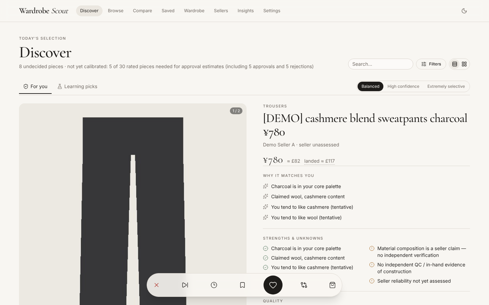 | 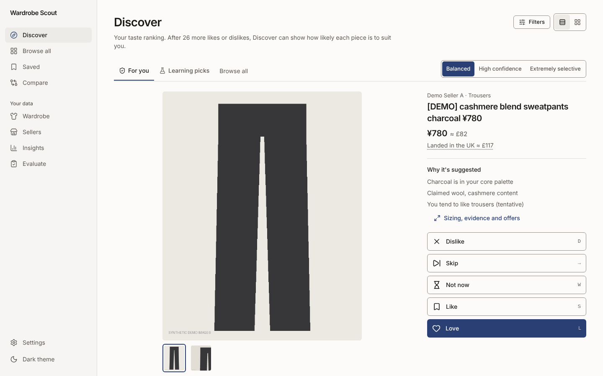 |
| Discover, phone | 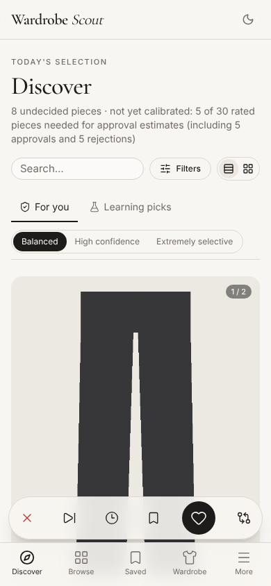 | 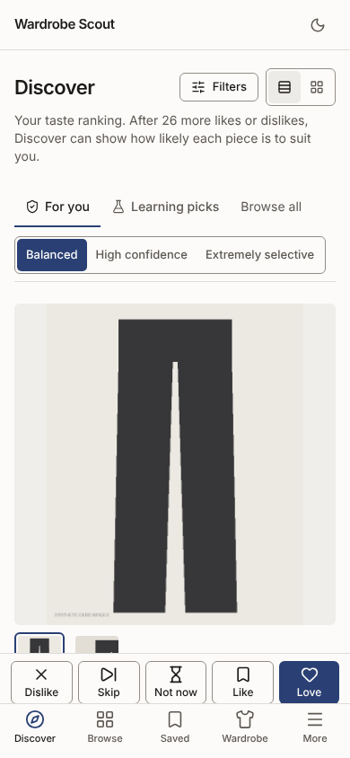 |
| Discover grid, desktop | 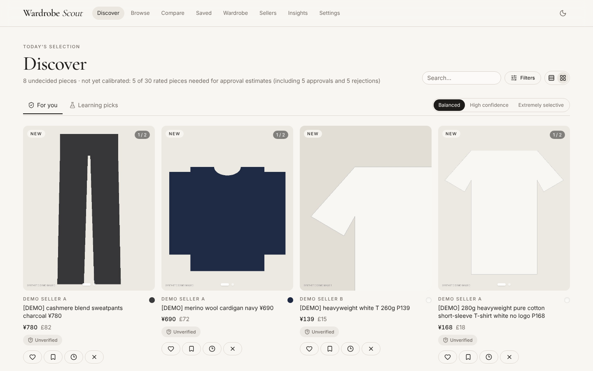 | 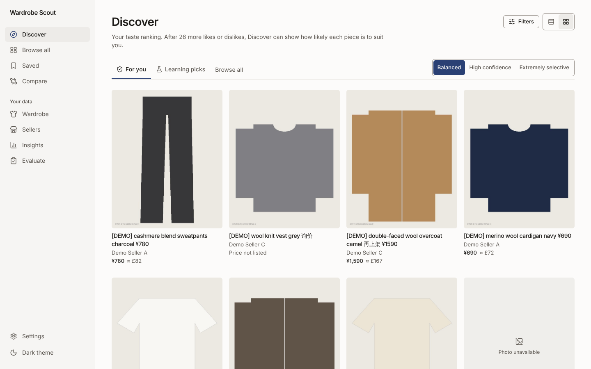 |
| Product, desktop | 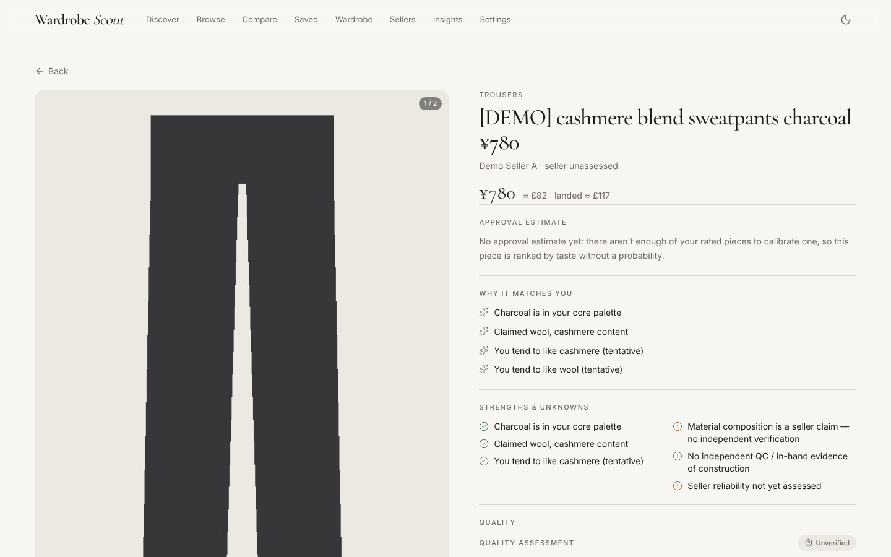 | 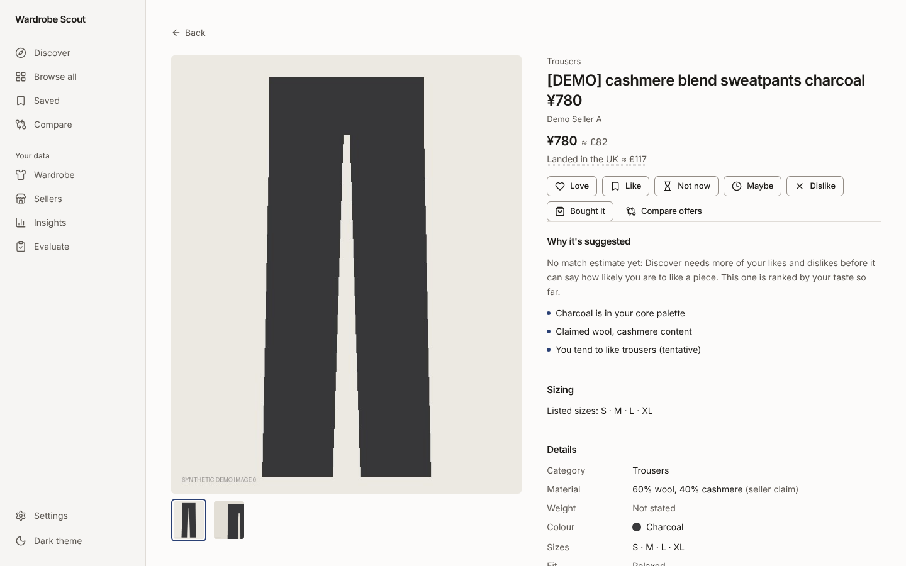 |
| Product, phone | 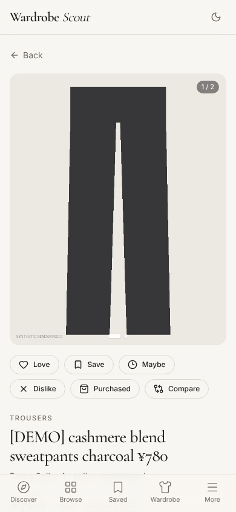 | 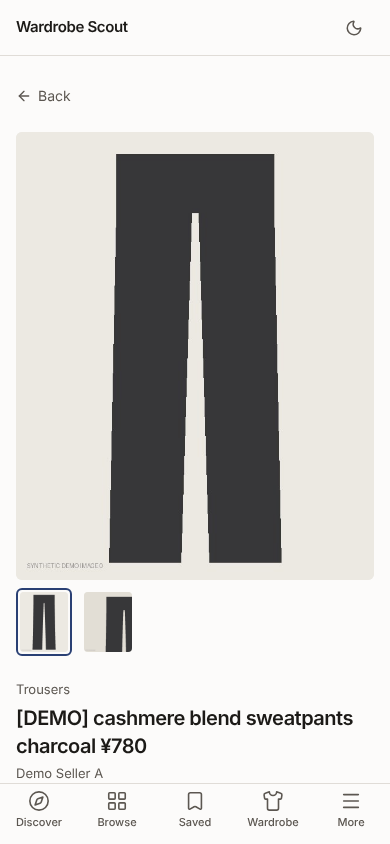 |
| Saved, desktop | 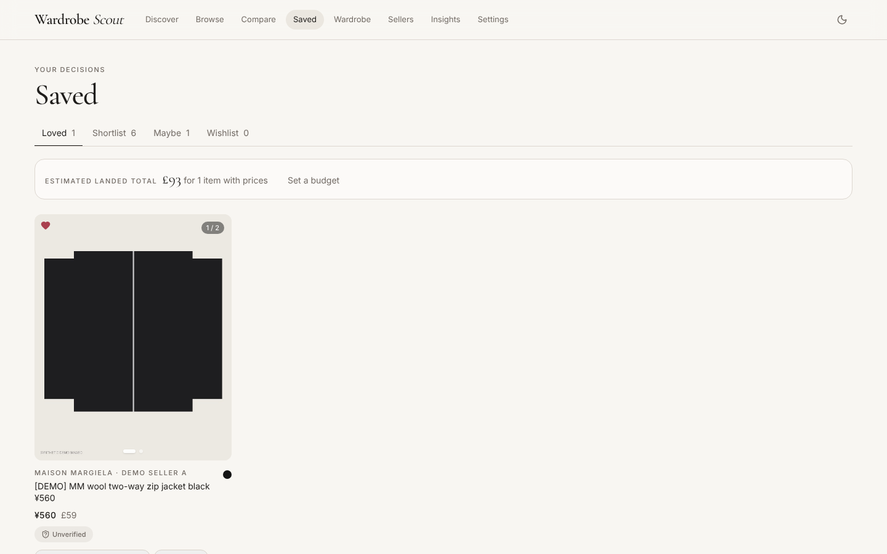 | 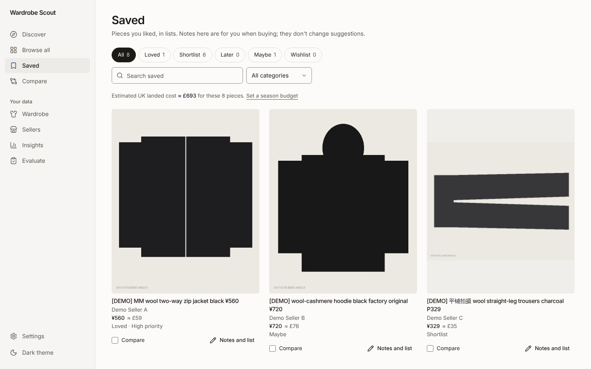 |
| Saved, phone, dark | 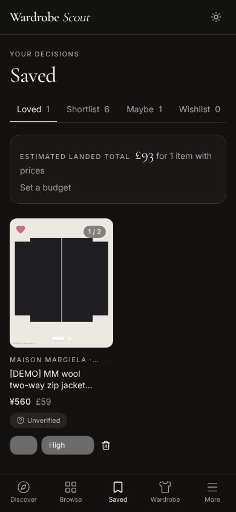 | 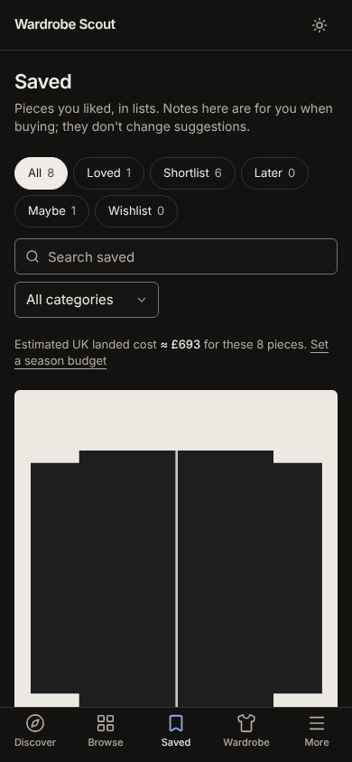 |
| Browse, tablet | 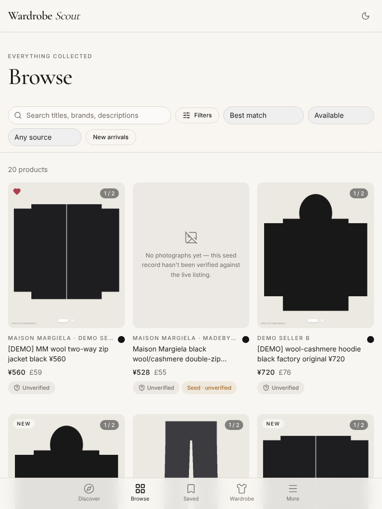 | 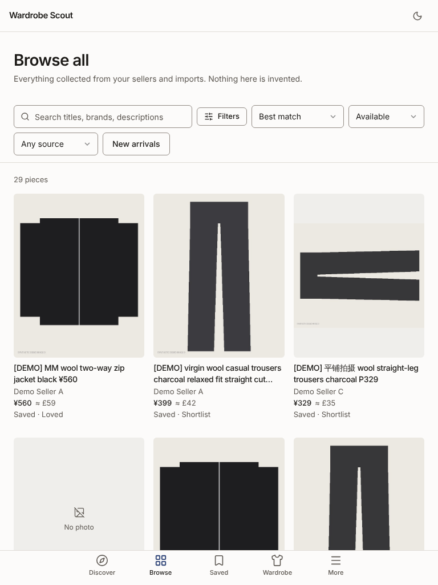 |
| Settings, desktop | 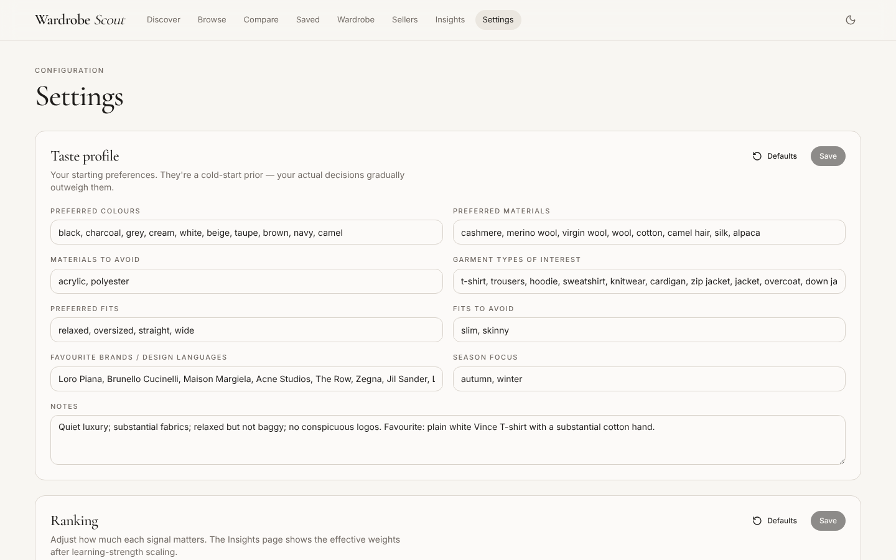 | 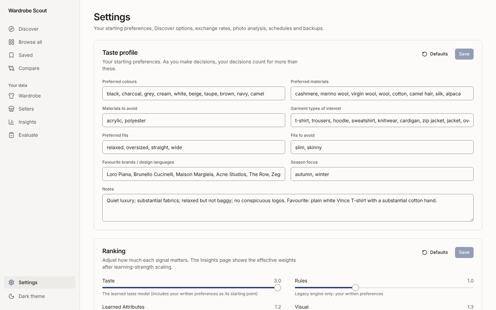 |

All 36 pairs are in `screens/before/` and `screens/after/` under the same names.

## Results: executed, synthetic, planned

### Executed here, on this branch

| Check | Result |
|---|---|
| Backend tests (`pytest -q`, Python 3.13.16) | **353 passed** (259 at the base). Also run on `86f1072` in a clean clone with a fresh environment installed from `constraints.txt`: 351 passed (two tests came after) |
| `ruff check .`, `pip check` | All checks passed; no broken requirements |
| Migrations | `alembic upgrade head`, `downgrade -1`, `upgrade head` on an empty database all succeed; the 24 revision triggers are installed |
| Rollback | On a database upgraded by this branch, the earlier code (`ccca8ad`, same migrations as the base) refuses to start ("Can't locate revision a4c7e2f9b1d3"). After `alembic downgrade f3d2c8a1e6b9` with the new code it starts, with no revision table or triggers left |
| Restore | Full-snapshot restore into a new folder (database and photos), refusal to overwrite, JSON backup round trip, and a restored copy getting its own cache instance: covered by the backend tests above |
| Frontend `tsc --noEmit`, `next lint` | exit 0, no warnings (the 3 pre-existing warnings were fixed) |
| Contrast (`frontend/scripts/contrast.mjs`) | 44 of 44 token pairs pass (text 4.5:1, controls and focus ring 3:1), light and dark |
| `next build` | exit 0 |
| End-to-end (`scripts/e2e.sh`, Chromium) | **31 of 31 passed**: 29 on desktop (including the layout checks from 320 to 1440 px), 2 on an iPhone viewport |
| CI on GitHub | `6586381`: backend, frontend and end-to-end jobs passed (end-to-end 31 passed in 1.0 min). Runs on `86f1072` and `86e5ab5` failed in one timing test; see N11 for the cause and fix. The result for the last commit is at the end of this file |
| Screenshots | 36 after-screenshots captured on the demo catalogue and looked at, at 1440, 768 and 390 px, light and dark; three problems found there were fixed (N9, the photo below the fold, the phone header) |
| Latency, SQL, memory | [03-performance.md](03-performance.md) |

What these do **not** show: anything about real taste accuracy, behaviour on real seller photos (the demo uses
drawn shapes), screen-reader use, or performance on your computer.

### Synthetic results (not evidence about your taste)

- The simulated-user figures in the README (precision@10 for profile-only, legacy and Bayesian engines) come
  from `backend/eval/` on simulated users. They describe a toy world. They were produced before this branch
  and were not re-run here; the evaluation regression tests that guard them (`tests/test_eval_regression.py`)
  pass.
- The latency figures in [03-performance.md](03-performance.md) are on a synthetic catalogue on this machine.
  Compare them with each other, not with your computer.
- No uplift claim is made for any change in this branch.

### Planned, not executed

- The real-data test: 150 to 300 products from the sellers you buy from, 40 to 60 Evaluate grades frozen
  before tuning, then `eval.selective` and `eval.real` ([02-measurement.md](02-measurement.md)).
- A screen-reader walkthrough (VoiceOver and NVDA) and a review of the new screens on real photos.

## Upgrade, backup and rollback

### Before upgrading: back up

Your products, decisions, saved lists, wardrobe, inspiration, evidence and manual matching decisions live in the
database and data folder. Take both kinds of backup:

1. **Settings → Export backup (JSON)**: everything personal; it imports into this version or a later one.
2. **A full snapshot** (database plus every photo), safe while the app runs:

```bash
cd backend
.venv/bin/python -m app.cli backup-full ~/wardrobe-scout-before-redesign.zip
```

```powershell
cd backend
.venv\Scripts\python -m app.cli backup-full $HOME\wardrobe-scout-before-redesign.zip
```

### Upgrade

```bash
git fetch origin && git checkout feature/redesign-and-fixes
cd backend && .venv/bin/pip install -r requirements-dev.txt -c constraints.txt
cd ../frontend && npm ci && npm run build
cd .. && ./scripts/start.sh
```

```powershell
git fetch origin; git checkout feature/redesign-and-fixes
cd backend; .venv\Scripts\pip install -r requirements-dev.txt -c constraints.txt
cd ..\frontend; npm ci; npm run build
cd ..; powershell -ExecutionPolicy Bypass -File scripts\start-windows.ps1
```

`-c constraints.txt` installs exactly the versions tested here (Python 3.13). Without it, pip keeps the versions
you have wherever they satisfy the requirements, which is how earlier upgrades worked.

On start, the database is upgraded in place. What that changes:

- **Added:** a small `data_revisions` table and database triggers that count changes (migration
  `a4c7e2f9b1d3`). Nothing existing is altered or removed.
- **Read differently, not rewritten:** your stored decisions are read under `aesthetic-v2`. Calibrations fitted
  under the earlier reading or engine are retired and refitted automatically once enough decisions qualify.
- New reason codes (`wrong_size`, `quality_unclear`, `not_now`) and a **Later** list appear only when you use
  them.

### Rollback

The earlier code cannot start on an upgraded database (it does not know the new migration), so downgrade the
database **with the new code first**, then switch the code back:

```bash
cd backend
.venv/bin/python -m alembic downgrade f3d2c8a1e6b9      # removes data_revisions and its triggers only
cd .. && git checkout feature/selective-recommendation   # or the commit you came from
cd frontend && npm ci && npm run build
```

```powershell
cd backend
.venv\Scripts\python -m alembic downgrade f3d2c8a1e6b9
cd ..; git checkout feature/selective-recommendation
cd frontend; npm ci; npm run build
```

What the earlier code then does with decisions made on this branch:

- A dislike with a new reason (`wrong_size`, `quality_unclear`) is read as a plain dislike of the look, as the
  earlier code read every dislike. Undo those decisions first, or restore the snapshot, if that matters.
- Pieces in **Later** stay in the database but the earlier Saved page has no tab for them. Move them to another
  list before rolling back.
- Undo of a removal made on this branch restores the list from your previous decision, as the earlier code
  always did; the priority and notes kept with it are not restored.

To return exactly to the state before the upgrade instead (losing decisions made since), restore the snapshot
into a new folder and point the app at it:

```bash
cd backend && .venv/bin/python -m app.cli restore-full ~/wardrobe-scout-before-redesign.zip --data-dir ~/ws-restored
WS_DATA_DIR=~/ws-restored ./scripts/start.sh
```

```powershell
cd backend; .venv\Scripts\python -m app.cli restore-full $HOME\wardrobe-scout-before-redesign.zip --data-dir $HOME\ws-restored
$env:WS_DATA_DIR="$HOME\ws-restored"; powershell -ExecutionPolicy Bypass -File ..\scripts\start-windows.ps1
```

`restore-full` only restores into a new, empty folder; it never overwrites an existing installation.

## Remaining work

- **Real taste accuracy is unproven.** Run the real-data plan before trusting the match estimates or the strict
  modes; the 80/90/95% targets are unvalidated aspirations, and the app says so.
- **Feed latency at 20,000 pieces** is still about 6 seconds per feed on this machine. Profiled, the rest is
  loading every candidate as an object (about 37%), the per-piece ranking loop (about 42%) and the gate (about
  13%); the next step is a per-piece feature table kept current by the same revision counters. At 5,000 pieces a
  feed takes about 1.3 seconds here.
- **Accessibility** was checked automatically (contrast, names, focus, targets, zoom, reflow, reduced motion);
  no assistive-technology walkthrough was done.
- **Design review on real photos.** The demo catalogue uses drawn shapes; the image well and tile proportions
  should be looked at with real listings.
- `@fontsource/cormorant-garamond` is no longer used and can be removed from `frontend/package.json` in a
  dependency update.

## Baseline (where this started)

| | |
|---|---|
| Base commit | `b37e41f51c3f6cb1f0f5fe7ebfe1c5d201bd58ca`, the head of `feature/selective-recommendation` (PR 1). It already contains `main` (57ba9e2), `audit/phase-1`, `audit/reliability-followup` and `perf/scanning`. |
| Backend tests (`pytest -q`, Python 3.13.16) | 259 passed in 165.6 s |
| `ruff check .` | All checks passed |
| `pip check` | No broken requirements |
| Frontend type-check (`tsc --noEmit`, Node 22.22.0) | exit 0 |
| `next lint` | 3 warnings, all pre-existing (unused `eslint-disable` directives in the Sellers and Settings pages) |
| `next build` | exit 0 |
| End-to-end (`scripts/e2e.sh`, Chromium from `/opt/pw-browsers`) | 16 of 16 passed |
| Screenshots | 36 captured into `screens/before/` |

How to reproduce any of the checks:

```bash
cd backend && .venv/bin/python -m pytest -q && .venv/bin/ruff check . && .venv/bin/pip check
cd ../frontend && npx tsc --noEmit && npx next lint && node scripts/contrast.mjs && npx next build
cd .. && PW_EXECUTABLE_PATH=/opt/pw-browsers/chromium-1194/chrome-linux/chrome ./scripts/e2e.sh
# screenshots: serve the demo, then capture
E2E_SERVE_ONLY=1 ./scripts/e2e.sh &
cd frontend && node scripts/screens.mjs http://localhost:13000 ../docs/redesign/screens/after
```
